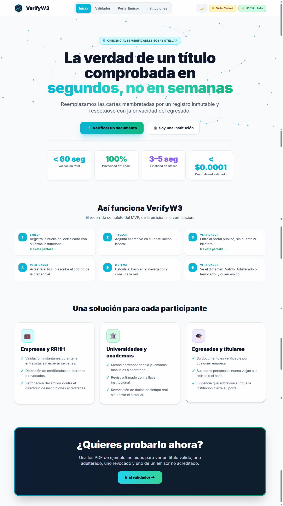
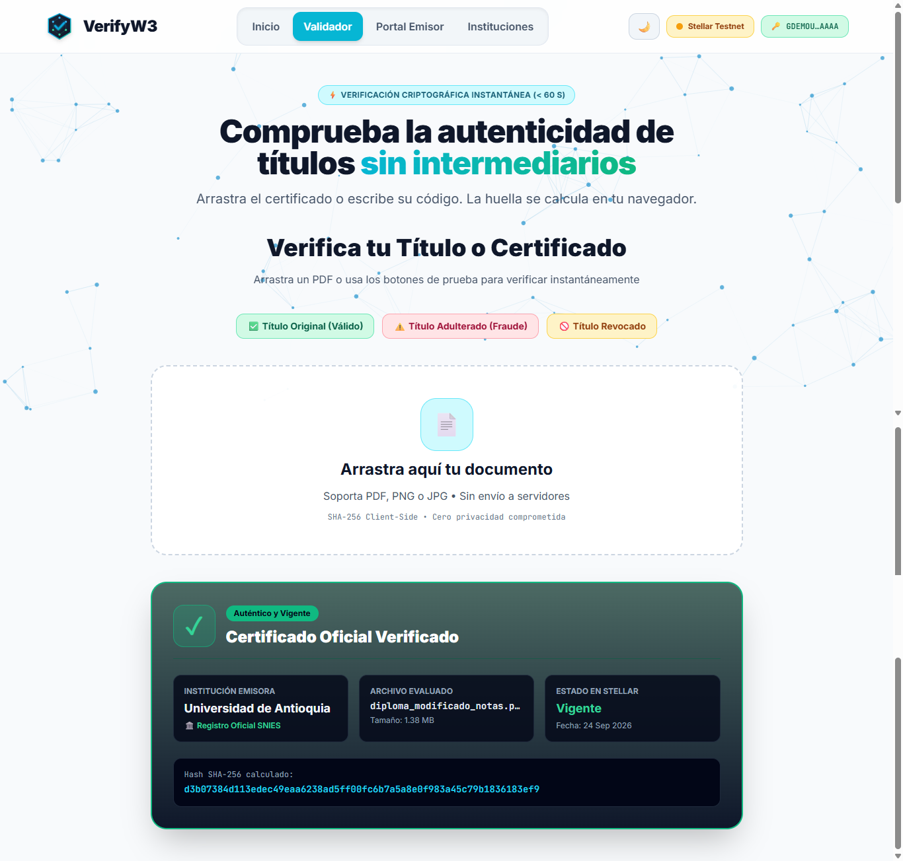
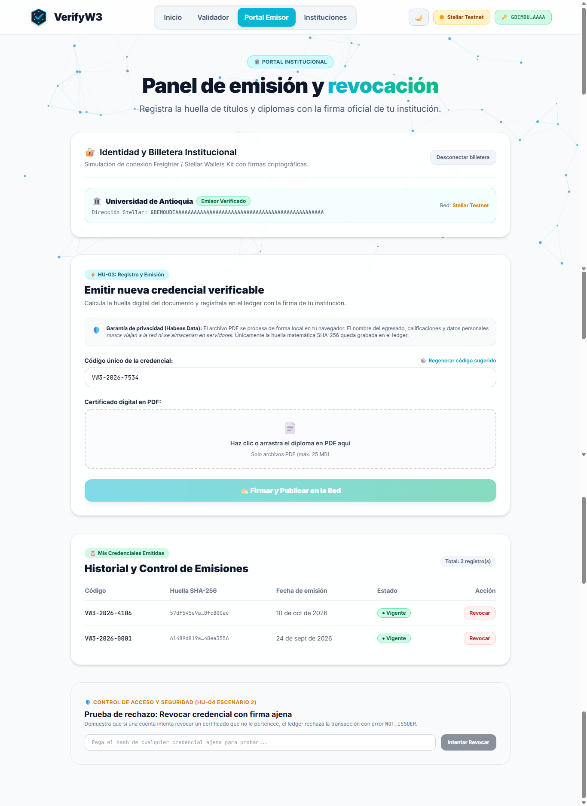
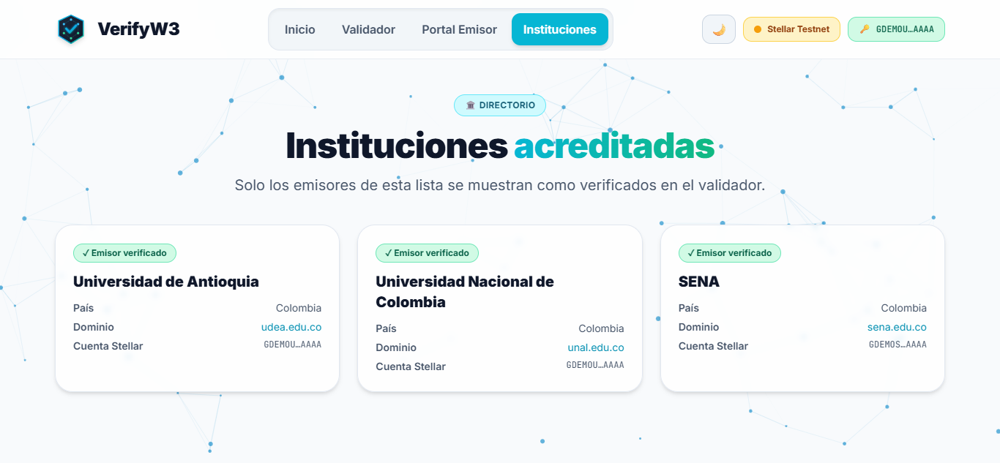

# Documentación — Semana 3 · Functional Proof (VerifyW3)

**Proyecto:** VerifyW3 — Verificación criptográfica de credenciales académicas en Stellar  
**Repositorio:** [roguar2010/VerifyW3](https://github.com/roguar2010/VerifyW3)  
**Entrega:** Módulo 3 · Functional Proof  

---

## 1. Front construido

Para esta entrega se construyó la interfaz funcional completa de **VerifyW3** utilizando **React 18**, **Vite** y **Tailwind CSS**. El frontend refleja de manera fiel el flujo principal de valor definido en el *Product Blueprint* (Semana 2), permitiendo recorrer de punta a punta la experiencia de los dos actores centrales del sistema: el **verificador/evaluador de talento humano** y la **institución educativa emisora**.

La aplicación web está estructurada en cuatro pantallas principales, totalmente navegables, responsivas y con soporte para modo claro y oscuro:

### A. Pantalla de Inicio (`/`) — Propuesta de Valor y Acceso Rápido
* **Propósito y conexión con el Blueprint:** Conecta directamente con la propuesta de valor del Problem Brief y el Lean Canvas. Explica el problema de las semanas de espera y los títulos falsificados en procesos de contratación, presentando la solución criptográfica instantánea.
* **Funcionalidad:**
  * Métricas visuales de impacto derivadas del Blueprint: tiempo de respuesta inferior a 60 segundos, 100 % de detección de alteraciones documentales y costo de verificación de \$0 para evaluadores.
  * Selector visual de roles que guía al usuario hacia el **Validador Público** o hacia el **Portal Institucional**.
  * Diagrama interactivo de los tres pasos del flujo de valor: *Cálculo local de huella $\rightarrow$ Consulta inmutable en Stellar $\rightarrow$ Dictamen de autenticidad*.

### B. Validador Público (`/verificar`) — HU-01, HU-02 y HU-05
* **Propósito y conexión con el Blueprint:** Es el núcleo del MVP para el usuario final (reclutadores, analistas de selección y entidades de control). Permite comprobar en segundos si un diploma es auténtico, si fue alterado o si ha sido revocado.
* **Componentes implementados:**
  * **Zona de carga (*Dropzone*) con privacidad garantizada:** Permite arrastrar o examinar cualquier archivo en formato PDF. Mediante la Web Crypto API (`crypto.subtle.digest`), el navegador calcula localmente el hash SHA-256 en milisegundos. El documento *nunca sale de la máquina del usuario ni se envía a ningún servidor*, cumpliendo con las normas de privacidad y Habeas Data (Ley 1581 de 2012).
  * **Consulta alternativa por código único:** Campo de entrada para buscar credenciales mediante su identificador alfanumérico (ej. `VW3-2026-0001`).
  * **Tarjeta de dictamen semafórico (`ResultCard`):** Presenta de forma clara el veredicto de la consulta:
    1. *Válido (Verde):* Credencial auténtica, vigente y vinculada a un emisor acreditado en el directorio. Muestra institución emisora, dominio oficial, país, fecha de expedición y huella digital.
    2. *Alerta de Fraude / No Encontrado (Rojo):* Notifica si el documento fue manipulado, alterado en sus notas o nombres, o si nunca fue emitido por una entidad autorizada.
    3. *Revocado (Ámbar):* Informa que la credencial existió legítimamente pero fue anulada por la institución, conservando la fecha de emisión y registrando la fecha exacta de revocación.
  * **Botonera de pruebas rápidas (Demos del MVP):** Cuatro accesos directos preconfigurados que cargan archivos PDF de muestra reales (`diploma_valido.pdf`, `diploma_adulterado.pdf`, `diploma_revocado.pdf`, `diploma_emisor_desconocido.pdf`) para evaluar los escenarios del Blueprint en un solo clic.

### C. Portal del Emisor (`/emisor`) — HU-03 y HU-04
* **Propósito y conexión con el Blueprint:** Diseñado para las secretarías académicas y coordinadores de instituciones educativas. Permite registrar nuevas credenciales en el ledger y gestionar la anulación de títulos expedidos con errores.
* **Componentes implementados:**
  * **Conexión de billetera institucional:** Selector que simula la autenticación criptográfica de entidades autorizadas (*Universidad de Antioquia, Universidad Nacional de Colombia, SENA*) y cuenta no acreditada de prueba (*Instituto Patito*). Si no hay una identidad conectada, el portal bloquea el acceso por seguridad.
  * **Formulario de emisión (HU-03):** Sugiere automáticamente un código formal de credencial (`VW3-2026-XXXX`) y solicita el PDF del título. Tras calcular el SHA-256 en cliente, el botón *"Firmar y Publicar"* registra la credencial en el ledger y entrega un recibo con el identificador de transacción (`Tx Hash`) y número de bloque (`Ledger Sequence`). Previene duplicados con el error `DUPLICATE`.
  * **Historial institucional y revocación (HU-04):** Tabla dinámica con todas las credenciales emitidas por la cuenta conectada, su estado (*Vigente* o *Revocada*) y botón de revocación individual con confirmación de seguridad.
  * **Módulo de prueba de control de acceso (HU-04 Escenario 2):** Permite verificar que si una entidad intenta revocar una credencial emitida por otra universidad, el ledger rechaza la transacción con el error `NOT_ISSUER`.

### D. Directorio de Instituciones Acreditadas (`/instituciones`) — HU-05
* **Propósito y conexión con el Blueprint:** Resuelve el supuesto crítico de identificar la legitimidad del emisor frente a entidades fraudulentas. Lista las instituciones reconocidas con su nombre oficial, país, dominio institucional enlazado y dirección pública de cuenta Stellar.

---

## 2. Decisión técnica

Para la arquitectura de **VerifyW3**, el equipo evaluó las alternativas del ecosistema y determinó unánimemente adoptar la **Opción A: Contrato propio en Soroban (Rust)**.

### Qué hará el contrato propio y por qué es necesario
El contrato inteligente de VerifyW3 operará como un registro soberano, inmutable y determinístico sobre la máquina virtual de Soroban (Wasm), ejecutando tres responsabilidades fundamentales:

1. **Almacenamiento inmutable de huellas documentales:** Guardará en el estado del contrato un mapa estructurado donde la clave es el hash criptográfico SHA-256 de 32 bytes del documento, asociado a su código de credencial, dirección pública del emisor (`Address`), timestamp de expedición y estado de validez (`Active` o `Revoked`).
2. **Control estricto de acceso y gobernanza de revocación:** Garantizará mediante verificación de firmas criptográficas que únicamente la entidad que emitió un certificado posea la facultad de revocarlo. Cualquier intento de anulación proveniente de una cuenta distinta será revertido a nivel de protocolo con el error `NOT_ISSUER`.
3. **Registro curado de emisores acreditados:** Mantendrá una lista de direcciones autorizadas correspondientes a universidades e instituciones avaladas por los entes educativos, impidiendo que emisores no reconocidos certifiquen bajo nombres suplantados.

### Por qué se descartó la Opción B (Soluciones existentes del ecosistema)
Se descartó utilizar herramientas o servicios preexistentes en Stellar (como emisión de tokens nativos, trustlines o contratos genéricos de custodia) por las siguientes razones:

* **Incompatibilidad con el modelo de privacidad *off-chain*:** Los estándares tradicionales de tokens o registros genéricos exigen asociar cuentas de usuarios o metadatos públicos en servidores de terceros. VerifyW3 requiere una arquitectura *Zero Knowledge* donde ningún dato personal (nombre, documento, calificaciones) viaje a la red ni dependa de bases de datos externas.
* **Falta de lógica condicional para revocación inmutable:** Los mecanismos estándar de transferencia de activos o claims no contemplan la relación lógica de expedición $\rightarrow$ comprobación $\rightarrow$ revocación conservando la marca de tiempo histórica sin borrar el registro.
* **Sostenibilidad y costos en Soroban:** Un contrato propio optimizado en Rust consume tarifas mínimas de CPU y almacenamiento (*State Archival*), permitiendo a una institución educativa certificar miles de diplomas por fracciones de centavo de dólar, manteniendo autonomía completa sin intermediarios ni comisiones de plataformas SaaS centralizadas.

---

## 3. Participación del equipo

| Integrante | Usuario de GitHub | Aporte y responsabilidad en este entregable |
|---|---|---|
| **Nicolás González Franco** | [@FRANGONICOLAS](https://github.com/FRANGONICOLAS) | Desarrollador. Arquitectura base del proyecto en React 18 / Vite / Tailwind CSS, diseño del layout con soporte oscuro/claro, pantalla de Inicio (`Home.jsx`), componente de dictamen y veredicto de validación (`ResultCard.jsx`) y Directorio de instituciones (`Institutions.jsx`). |
| **Ronald Guarín** | [@roguar2010](https://github.com/roguar2010) | Líder Técnico. Implementación completa del Portal del Emisor (`Issue.jsx`), lógica de conexión de billetera institucional con `useWallet()`, flujo de emisión con cálculo de SHA-256 en cliente, gestión de credenciales con revocación inmutable y módulo de prueba de seguridad para control de acceso `NOT_ISSUER`. |
| **Estefany Carolina Guerra G** | [@Eguerrag](https://github.com/Eguerrag) | Project Manager. Coordinación del entregable, definición y prueba de los 4 escenarios de evaluación del MVP, e implementación de la entrada del validador (`VerifyInput.jsx`) con zona de arrastre (*dropzone*), búsqueda por código y botonera de pruebas rápidas con diplomas de muestra. |

---

## 4. Bloqueos y siguiente paso

### Bloqueos y alcance actual
En este entregable no se presentaron bloqueos críticos de desarrollo. El frontend opera de manera íntegra utilizando una capa de abstracción desacoplada en `src/services/ledger.js`. Dicho módulo utiliza almacenamiento local (`localStorage`) y funciones de retardo programado (`delay`) para simular con precisión la latencia de red de Stellar (900 ms para lecturas RPC y 1.500 ms para escrituras). Esto permitió validar la usabilidad y los flujos del MVP sin exigir extensiones Web3 ni saldo en Testnet a los evaluadores en esta etapa.

### Siguiente paso hacia el MVP final (Semana 4 · Integrar)
1. **Desarrollo del Smart Contract en Soroban:** Programar en Rust el contrato inteligente con los tipos de datos de credenciales, control de firmas `require_auth` y lista de emisores.
2. **Despliegue en Stellar Testnet:** Publicar el contrato compilado en WebAssembly en la red de pruebas de Stellar.
3. **Integración con Billetera Freighter y Stellar SDK:** Reemplazar la simulación de `ledger.js` conectando la extensión de billetera **Freighter** mediante `@stellar/stellar-sdk` y Soroban RPC, habilitando firmas criptográficas y transacciones reales on-chain.
